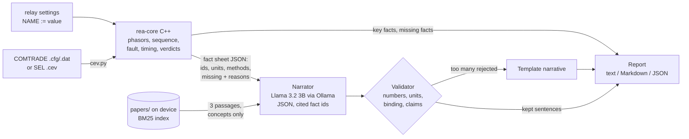

# Relay Event Analyst

**An offline event analyst for protective relays.** A C++ physics core reads a COMTRADE record (or an
SEL `.cev` event report), finds the fault, and checks the relay's timing against its settings
(IEEE C37.112 inverse-time curves). A local 3B language model explains the result in plain English, and
a validator rejects every sentence that contains a number the physics core did not produce. Nothing
leaves the device: it runs on an NVIDIA Jetson with the network cable unplugged.

```
$ rea analyze "Exercise 2.CEV"      # SEL-311L event from SEL's event-analysis webinar
WHAT HAPPENED                        (Llama 3.2 3B via Ollama, every sentence checked)
  The fault was detected as a C-A phase-to-phase fault, with no ground involvement, at the start of the record.
  The fault occurred in the forward direction relative to the relay.
  The largest phase fault current was in phase C, with a value of 169 A in the primary system and 0.71 A
  in the secondary system.
  The relay tripped after the fault had ended, with a trip time of 348.96 ms and 20.94 cycles.
  The fault current ended due to the current returning to the load before any local trip.
  Phase rotation check: the record shows ACB rotation but the relay is set PHROT := ABC.
  ...
VALIDATOR  8/8 model sentences passed | 5/5 numbers shown are traced to core facts | model skipped
           rotation check: added the template sentence
```

That event is real: SEL publishes it with its webinar *Introduction to Event Analysis Using Actual Field
Cases*. The relay tripped on Zone 2 time. rea-core found two things. First, the fault current had already
stopped, with the local breaker still closed, 21 cycles before the trip. Second, the voltages and
currents in the record rotate A-C-B while the relay is set for A-B-C. A relay set for the wrong rotation
computes positive and negative sequence swapped, so balanced load looks unbalanced to it. A trip on load
fits that: it came 20.94 cycles after the fault ended, and the record's Zone 2 delay setting is 20 cycles.
The relay's own event summary agrees: it lists balanced phase currents (204 A in each phase) with
3I2 = 614 A. Balanced currents have no negative sequence; three times the phase current is exactly what a
relay computes when its rotation setting is the reverse of the actual rotation.
This is rea-core's reading of the record, not SEL's published answer.

## What it does

| Stage | What | Where |
|---|---|---|
| **Physics core (C++17)** | COMTRADE 1991/1999/2013 reader (ASCII, BINARY, BINARY32, FLOAT32); cosine and full-cycle DFT phasors; symmetrical components with measured phase rotation; fault inception, type (10 classes), negative-sequence directional element (32Q-style z2), peak and RMS current; relay operate time; per-pole breaker clearing; expected operate time by replaying the measured currents through the 50/51 elements on the U1-U5 and C1-C5 curves (IEEE C37.112 integral form); verdicts. Output: a fact sheet in which every number has an id, a unit and a method, and anything unknown is an explicit "missing" fact with a reason. | [`core/`](core) |
| **SEL `.cev` reader** | Reads SEL compressed ASCII event reports (per-line checksums, Relay Word bits) and writes COMTRADE plus the relay settings found in the record. On SEL's practice event it reproduces SEL's own COMTRADE conversion: 0 of 113,280 digital samples differ, analog values within 0.004 A. | [`python/rea/cev.py`](python/rea/cev.py) |
| **Narrator** | Llama 3.2 3B through Ollama (or any OpenAI-compatible llama.cpp server), loopback only. The model gets the fact sheet, the UNKNOWN list and up to three passages from your local papers, and must answer as JSON sentences that cite fact ids (grammar-constrained, with the ids as an enum). | [`python/rea/`](python/rea) |
| **Validator** | Rejects any sentence with a number that is not a core fact at the precision written, in a compatible unit, and bound to that fact (cited, or about the same thing). Also rejects contradictions of the fault type, direction and verdicts, comparisons the numbers do not support, and times quoted from the wrong reference. If too much is rejected, the deterministic template narrative is shown instead. Missing facts are always listed. | [`python/rea/validator.py`](python/rea/validator.py) |
| **Eval** | Synthetic events with exact ground truth (sequence-network fault solver), a red team that injects 11 kinds of error into correct narratives, SEL's real webinar events, and Jetson timing and power from `tegrastats`. | [`python/rea/evaluation/`](python/rea/evaluation) |

## Results

Measured on an x86-64 build machine unless stated. Full tables: [eval/results/RESULTS.md](eval/results/RESULTS.md),
[eval/real/REAL_EVENTS.md](eval/real/REAL_EVENTS.md).

**Physics core, 1,000 synthetic events** (seed 7, 10 fault types, forward and reverse, 6 injected relay
and breaker problems, 8/16/32 samples per cycle, measurement noise, frequency off by up to 0.05 Hz):

| Metric | Result |
|---|---|
| Fault type | 100.0% |
| Direction | 100.0% of the 99.8% of events where it decides; it abstains on the rest |
| Relay verdict (as expected / slow / fast / failed to trip / tripped outside its zone ...) | 100.0% |
| Breaker verdict | 100.0% |
| Fault inception error | median 0.41 ms, max 3.69 ms (max 1.95 samples) |
| Trip time error | max 2.08 ms |
| Expected operate time vs closed form | median 0.65 cycles, max 1.05 cycles |
| Fault current magnitude error | p95 1.25%, max 4.05% |
| Core time per event | median 2.7 ms including process start |

A second set (seed 2026) gives 99.9% fault type and the same 100% on verdicts, and a fresh 200-event set built
from the packaged zip (seed 11) gives 99.5% fault type (one BG read as BCG) and 100% on verdicts. Every miss in
all three sets is a record that starts after the fault began, which is the documented hard case.

**Validator red team**: the correct template narrative of each of the 1,000 events was copied and one
error injected per copy: 49,940 errors of 14 kinds, 99.1% caught, and 0 of 7,851 correct sentences
rejected. Three kinds copy errors the hand audit found the model making (the 52A opening time as the
interrupting time, the operate time as the deviation, the wrong breaker ending the fault). Every kind
is caught 100% of the time except one: a number swapped for the value of another fact of the same
kind passes 0.6% of the time when the sentence cites its facts and 6.0% when it does not. That is
why the model must cite.

**Real events (SEL's webinar files)**: rea-core's fault type matches the relay's own event type on both
fault records (SEL-351R: CA; SEL-311L: CA). For the SEL-311L it adds the rotation mismatch and the late
trip described above. The three SEL-710 motor records are motor starts and trips, which are outside
the scope of a fault analyzer; see [REAL_EVENTS.md](eval/real/REAL_EVENTS.md).

**Local LLM** (Llama 3.2 3B Instruct Q4_K_M in Ollama 0.40.2, CPU only, 4-vCPU x86, no retrieval):
20 synthetic events, median 45.1 s per event at 8.6 tokens/s. The model proposed 153 sentences.
Read by hand, 15 were wrong; the validator removed 9 of them. It also removed 10 correct sentences,
9 of which give the fault inception relative to the trigger without naming the trigger. The 6 wrong
sentences it kept quote the 52A opening time as the interrupting time, quote the operate time in
cycles as the deviation from the expected time, or misstate what the direction or a non-trip means.
Details and every wrong sentence: [eval/narration-x86/RESULTS.md](eval/narration-x86/RESULTS.md).

**Jetson**: `scripts/bench_jetson.sh` measures seconds per event and board power with `tegrastats`
(idle baseline, then N narrated events, joules per event). Not measured yet; numbers go here when
they exist.

## Architecture



The core runs as a separate process with no network or file-write needs, so it can be sandboxed
apart from the language model. The language model only ever sees the fact sheet. See
[docs/architecture.md](docs/architecture.md).

## Quick start

On any Linux machine (x86 or Jetson):

```bash
make core test                       # build rea-core (C++17, -Werror) and run C++ + Python tests
PYTHONPATH=python python3 -m rea analyze data/demo/demo_cag_slow_relay.cfg --backend template
make synth eval                      # 1,000 labeled events -> eval/results/RESULTS.md
```

With the local model (Ollama installed and `ollama pull llama3.2:3b` done once while online):

```bash
PYTHONPATH=python python3 -m rea doctor                # core, model, papers, network state
PYTHONPATH=python python3 -m rea analyze data/demo/demo_bg_51g_normal.cfg --md out/report.md
```

On a Jetson (JetPack 6): `scripts/jetson_setup.sh` installs the build tools and Ollama, pulls the model,
builds and tests. Then unplug the network and run `scripts/demo.sh` (60-second demo; shot list in
[docs/demo-script.md](docs/demo-script.md)) and `scripts/bench_jetson.sh` (timing and power).

Real events: `make real` downloads SEL's example files once (they are SEL's, so they are not in this
repository), converts the `.cev` reports and writes [eval/real/REAL_EVENTS.md](eval/real/REAL_EVENTS.md).
Any single event: `PYTHONPATH=python python3 -m rea analyze path/to/event.cev`.

Papers: `scripts/fetch_papers.sh` downloads the SEL technical papers listed in
[papers/sel-papers.txt](papers/sel-papers.txt) into `papers/` (git-ignored) and indexes them. Six
papers give 557 passages, indexed in about 4 s. Any PDF you add is picked up too.

### Container

```bash
docker compose -f docker/compose.yaml build
docker compose -f docker/compose.yaml run --rm rea analyze /events/demo_bg_51g_normal.cfg --md /out/report.md
```

One application container with a read-only root filesystem, a non-root user, every Linux capability
dropped, no-new-privileges, a tmpfs for scratch, and read-only mounts for events and papers. The model
stays in Ollama on the host, where it can use the GPU. The container reaches it on 127.0.0.1 only, and
`rea` refuses any non-loopback model address. Checked on x86-64: it runs as uid 10001, writes to `/usr`
fail, the effective capability set is 0, and `rea doctor` reaches the model on loopback. The arm64
image is built in CI under QEMU; it has not been run on a Jetson yet.

## Design decisions

- **Numbers come only from the core.** The model gets no raw samples and its output is not trusted. Every
  number it writes has to match a fact at the precision written and in a compatible unit, and be bound to
  that fact. The template narrator passes the same validator by construction, so there is always a safe
  fallback.
- **Missing is a value.** When the record cannot answer a question (no trip channel, fault already present
  when the record starts, no voltage transformers), the core emits a missing fact with the reason, the model
  is told it is UNKNOWN, and the report lists it under COULD NOT BE DETERMINED.
- **Settings, not guesses.** Expected operate time comes from replaying the measured currents through the
  configured elements. Without settings the verdict is "undetermined"; the tool does not guess.
- **Measure the rotation.** Sequence components use the rotation the record shows, and a PHROT setting that
  disagrees is reported. That is how the SEL-311L finding above appears.
- **Small model, constrained output.** A 3B model on a Jetson is affordable. JSON with an enum of fact ids
  makes citations cheap to check. The validator, not the model, is what makes the output safe to read.

## Limitations

- Synthetic events come from this project's own simulator; real-event checks so far are two fault
  records from SEL's webinar, without ground-truth labels.
- Elements modeled: 50P1, 51P1 and 51G1 (U1-U5, C1-C5) with directional supervision. Distance, differential
  and recloser curves are not modeled, so their verdicts are "undetermined" unless the timing alone settles
  it (for example a trip after the fault had ended).
- No motor or transformer models: starting and inrush currents look like disturbances (flagged when they
  follow a breaker close).
- Faults shorter than the phasor window (about 1.25 cycles) get underestimated magnitudes, and the report
  says so.
- The validator checks numbers and a set of categorical claims. It cannot check every relation a sentence
  states, so the key-facts table is always printed next to the narrative.
- Jetson timing and power are not measured yet.

## Layout

```
core/            C++ physics core, GoogleTest suite (89 tests)
python/rea/      CLI, CEV reader, narrator, prompts, validator, retrieval, LLM clients, report
python/rea/synth/        fault simulator and COMTRADE writer (ground-truth labels)
python/rea/evaluation/   core scoring, validator red team, narration stats, tegrastats, real events
tests/           Python tests (pytest)
data/demo/       five curated synthetic events with settings and labels
docker/          Dockerfile and compose file
scripts/         Jetson setup, demo, benchmark, tegrastats logging, paper fetching
docs/            physics, architecture, validator, demo script
eval/            results
```

Not affiliated with or endorsed by Schweitzer Engineering Laboratories. SEL, SEL-311L, SEL-351R and
SEL-710 are SEL product names, used here only to identify the example files. MIT licensed.
