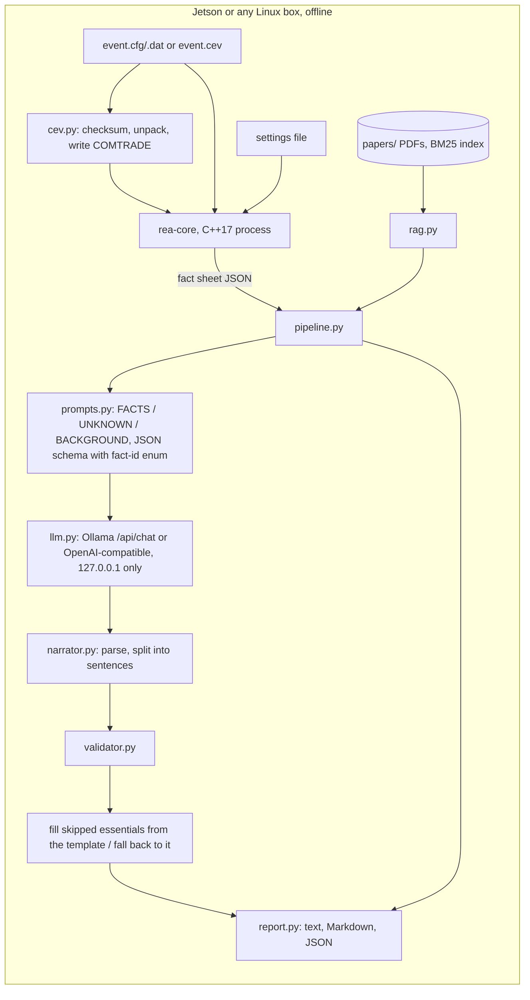

# Architecture



## Process boundaries

* **rea-core** is a standalone executable (`rea-core analyze <cfg> [--settings F] [--filter
  cosine|dft] [--compact]`). It reads files and writes JSON to stdout. It does no networking and
  writes no files, so it can be sandboxed on its own (seccomp, a read-only mount). Python runs it as
  a subprocess: `core_runner.py`.
* **The language model** runs in Ollama (or llama.cpp's server). `llm.py` refuses any host that is
  not 127.0.0.1, ::1 or localhost, unless `REA_ALLOW_REMOTE_LLM=1` is set deliberately. It also
  ignores `HTTP(S)_PROXY`, so a loopback request is never routed through a proxy.
* **The container** (`docker/`) holds rea-core and the Python package, runs as UID 10001 with a
  read-only root, no capabilities, `no-new-privileges` and a tmpfs `/tmp`, and shares the host's
  network namespace only to reach Ollama on loopback.

## Ollama settings

`scripts/jetson_setup.sh` adds a systemd drop-in for the Ollama service
(`/etc/systemd/system/ollama.service.d/rea.conf`):

| Variable | Value | Why |
|---|---|---|
| `OLLAMA_HOST` | `127.0.0.1:11434` | loopback only |
| `OLLAMA_NO_CLOUD` | `1` | no cloud models or account features; Ollama 0.40.2 logs "Ollama cloud disabled: true" |
| `OLLAMA_KEEP_ALIVE` | `30m` | the model stays loaded between events |
| `LLAMA_ARG_CACHE_RAM` | `0` | Ollama 0.40.2 runs llama-server, whose prompt cache defaults to 8 GiB of host RAM. On the 8 GB x86 build machine the runner was killed for running out of memory during the 20-event run; with 0 it logs "prompt cache is disabled" and the rerun completed |

These were found on Ollama 0.40.2 on x86. A Jetson may run a different Ollama version; check
`journalctl -u ollama` for the same log lines.

## The fact sheet (schema `rea.facts/1`)

```json
{"id": "relay.operate_ms", "kind": "number", "value": 603.13, "display": "603.13", "unit": "ms",
 "label": "Relay operate time (inception to trip output)", "method": "trip edge - inception", "priority": 1}
{"id": "fault.inception_ms", "kind": "missing", "reason": "the fault was already present when the record started",
 "label": "Fault inception", "priority": 1}
```

`priority` 1 marks headline facts: they always go to the model and always appear in the report's
key facts, and when one is missing it is listed under COULD NOT BE DETERMINED. Warnings (for
example "INOM not set", "phase rotation ...") travel with the sheet and are printed under CORE
WARNINGS.

## Narration

1. `select_facts`: every priority-1 fact plus supporting facts (settings, z2, 3I0, pole order), in
   the order the explanation should follow.
2. The prompt lists FACTS (`id = value unit (label; reading aid)`), UNKNOWN (id: reason) and
   BACKGROUND passages, which are for concepts only.
3. Output schema: `{"sentences": [{"text": str (max 280), "fact_ids": [enum of given ids]}]}`, at
   most 8 items. Ollama's `format` and llama.cpp's `json_schema` turn it into a grammar, so the
   model cannot cite an id it was not given.
4. JSON that was cut off is salvaged item by item. Items that hold several sentences are split, so
   each sentence is validated on its own.
5. If at most half the sentences are rejected and at least 3 survive, the model's sentences are
   shown. Any essential topic the model skipped (fault type, relay action, verdict, a rotation
   mismatch, a late trip) gets the template's sentence, and the audit says so. Otherwise the whole
   template narrative is shown, with the model's rejected sentences still listed in the audit.

## Retrieval

BM25 over 140-word passages of the PDFs, `.txt` and `.md` files in `papers/` (standard library
only; PDF text via pypdf or poppler). The query is built from the core's findings (fault type,
ground, direction, element type, verdict). The index is cached next to the papers, or in
`REA_INDEX_DIR` when the papers folder is mounted read-only, and rebuilt when files change. The
report names the file and page of each passage.

## Evaluation

* `rea-synth`: labeled synthetic events. Sequence-network solution of a two-source line; waveforms
  with decaying DC; per-pole clearing at current zeros; relay behaviour in closed form. Injected
  problems: slow relay, wrong curve, slow breaker, breaker failure, trip for a reverse fault, failure
  to trip.
* `rea-eval`: scores the core on the labeled set, runs the validator red team, and optionally
  narrates N events with the local model and parses a tegrastats log.
* `rea-real` (`python -m rea.evaluation.real_events`): SEL's webinar events, compared with the
  relay's own event summary.
* `scripts/bench_jetson.sh`: environment capture, model warm-up, idle power baseline, a measured run
  with tegrastats, J/event.
